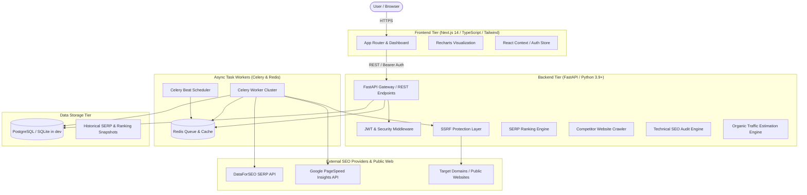

# RankScope — Architecture & System Design

RankScope is an enterprise-grade, independent SEO intelligence platform inspired by SEMrush, Ahrefs, and Moz.

---

## 1. High-Level System Architecture

---

## 2. Core Subsystems

### A. Modular SERP Engine (`app.services.serp`)
- **Abstract Provider Interface:** `BaseSerpProvider` decoupling backend business logic from data vendors.
- **DataForSEO Integration:** Direct JSON REST communication targeting Google Organic SERP API with support for device, location, and language parameters.
- **Mock Provider:** Deterministic mock provider for CI/CD and cost-free local testing.

### B. High-Performance Website Crawler (`app.crawlers`)
- Built using **HTTPX** and **BeautifulSoup4** (with Playwright headless browser fallback for JS-heavy client apps).
- **Hardened SSRF Guard:** Strict URL validation preventing access to RFC 1918, loopback (127.0.0.1), link-local, AWS metadata endpoints (169.254.169.254), and internal network ranges.
- **Politeness & Compliance:** Configurable crawl delay, depth limits, page caps, and robots.txt checking.

### C. Ranking & History Pipeline (`app.models.models`)
- Normalized schema maintaining an append-only `ranking_history` table for tracking keyword position movements, new rankings, and lost rankings.

### D. Traffic Estimation Model
- Formula: $\text{Estimated Organic Traffic} = \text{Search Volume} \times \text{Position CTR Curve}$
- Clear labeling on all outputs indicating estimations vs verified rank observations.
